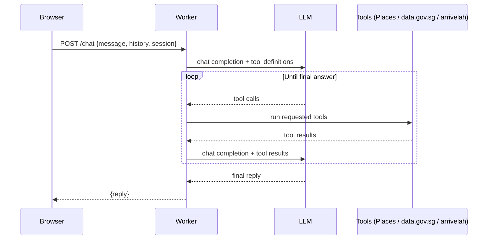

# Lunch Uncle

Lunch Uncle is a chatbot that tells you where to eat lunch near CT Hub 2, Lavender, Singapore. Uncle speaks casual Singaporean English, and he has strong opinions about where you should go.

## Architecture

Lunch Uncle runs as a single Cloudflare Worker. `src/index.js` routes requests: `GET /` serves the chat page from `src/ui.html`, and `POST /chat` goes to `src/chat.js`, which rate-limits and checks the request, then hands the turn to the agentic loop in `src/loop.js`. The loop calls an OpenAI-compatible chat completions endpoint, passing the tool definitions from `src/tools.js`. When the model asks for tool calls, the loop runs them, appends the results to the message list, and calls the model again. This repeats until the model gives a final answer with no more tool calls, for at most 8 rounds. `src/prompt.js` builds the system prompt that sets Uncle's persona and rules, and stamps each user message with the Singapore time. There are three tools: `find_lunch_places`, which queries the Google Places API (New) Text Search, restricted to the area around CT Hub 2; `get_rain_forecast`, which reads the two-hour forecast from data.gov.sg (no key needed); and `get_bus_arrivals`, which reads live arrivals from arrivelah (no key needed).

The page shows a map next to the chat. `GET /places` in `src/map.js` uses Places API (New) Nearby Search to find the three places to eat closest to the browser's location, or to CT Hub 2 if the user does not share it. It returns each place's rating, opening status, distance, two reviews, up to two photos and a Google Maps link. When Uncle recommends places in the chat, `POST /chat` also returns cards for them, built in `src/cards.js` from what his searches found, and the panel switches to "Uncle's picks". Uncle may name a place by a shortened name ("Lai Soon", "Yi Ping"), and the page sends the places it already has cards for in `known`, so he can name one of those again without a new search. `GET /config` gives the page the public browser key and map ID it needs to draw the interactive Google map. Without a browser key, or if Google rejects it, the page shows Google's basic embedded map instead. That map needs no key, but it shows one place at a time rather than pins.

## Request flow



## Setup

1. Clone this repository.
2. Install dependencies:
   ```sh
   npm install
   ```
3. Create `.env` from `.env.example` and fill in your keys:
   ```sh
   cp .env.example .env
   ```
   ```
   OPENCODE_API_KEY=your-key-here
   GOOGLE_PLACES_API_KEY=your-key-here
   ```
   If a `.dev.vars` file also exists, wrangler reads that instead and ignores `.env`.

   For the interactive map, also add `GOOGLE_MAPS_BROWSER_KEY`, a separate key described in [Map key setup](#map-key-setup). Without it, the page shows Google's basic map, which needs no key: it shows your location, then whichever place you pick.
4. Fill in the two `TODO` constants at the top of `src/loop.js`: `LLM_BASE_URL` and `LLM_MODEL`, for the OpenCode Go endpoint and model. The Go endpoint requires an `x-opencode-session` header, which `callModel` already sends.
5. Start the dev server:
   ```sh
   npm run dev
   ```
   Open http://localhost:8787 and chat with Uncle.
6. To deploy, set the secrets on Cloudflare first, then deploy:
   ```sh
   npx wrangler secret put OPENCODE_API_KEY
   npx wrangler secret put GOOGLE_PLACES_API_KEY
   npm run deploy
   ```
   `wrangler.toml` limits each client IP to 30 chats a minute. Workers in one Cloudflare account that use the same `namespace_id` share that limiter, so give your Worker its own number in the `[[ratelimits]]` block.

Secrets never go in code or in `wrangler.toml`. Local development reads them from `.env`, which is gitignored; production reads them from Cloudflare secrets set with `wrangler secret put`.

## Running tests

```sh
npm test
```

This runs Node's built-in test runner. There are no test dependencies to install.

## Course key setup

For facilitators setting up a shared Google Places key for a course run:

1. In Google Cloud Console, create a new project for the course.
2. Enable **Places API (New)** only. Do not enable the legacy Places API.
3. Create an API key under APIs & Services → Credentials.
4. Under key restrictions, choose "Restrict key" and tick only Places API (New).
5. Go to APIs & Services → Places API (New) → Quotas, and cap requests per day to a modest number, such as 1,000.
6. In Billing → Budgets & alerts, create a budget with email alerts at 50% and 100%.

Treat the LLM key the same way: one key per course run, revoked once the course ends.

Each page load costs one Nearby Search at the Enterprise + Atmosphere rate, because it includes reviews, plus up to six Place Photos requests. Each chat search (`find_lunch_places`) is a Text Search at the same rate, because it also fetches reviews for the cards, and up to six more Place Photos requests are made when Uncle recommends places. The same per-IP rate limit covers `/places` and `/chat`.

## Map key setup

The interactive map, with a pin for each place and a dot for you, needs a second Google key. It is sent to every visitor's browser, so it must never be the Places key. Without one, the page falls back to Google's basic map, which needs no key.

For prototyping, the quickest free option is a [Maps Demo Key](https://developers.google.com/maps/demo-key). Sign in with a personal Google account, click **Get a Demo Key**, and use the key as `GOOGLE_MAPS_BROWSER_KEY`. It needs no billing details, so it cannot be charged, but it is not meant for production, and it pauses for the rest of the day if it reaches its daily limit.

For a deployed app, create a regular key. Maps JavaScript API includes 10,000 free map loads a month, but the project needs billing turned on:

1. In the same Google Cloud project, enable **Maps JavaScript API**.
2. Create a new API key. Restrict it to **Maps JavaScript API** only.
3. Under application restrictions, choose **Websites** and add `http://localhost:8787/*` and your Worker's address, such as `https://lunch-uncle.<your-subdomain>.workers.dev/*`.
4. Put it in `.env` as `GOOGLE_MAPS_BROWSER_KEY`. For deploys, run `npx wrangler secret put GOOGLE_MAPS_BROWSER_KEY`.
5. Under the Maps JavaScript API's quotas, cap map loads per day, for example at 300, so a month stays within the free 10,000.
6. Optionally, create a map ID under Map Management and set it as `GOOGLE_MAPS_MAP_ID`. Without one, the page uses Google's `DEMO_MAP_ID`, which is meant for testing.

## Licence

MIT.
